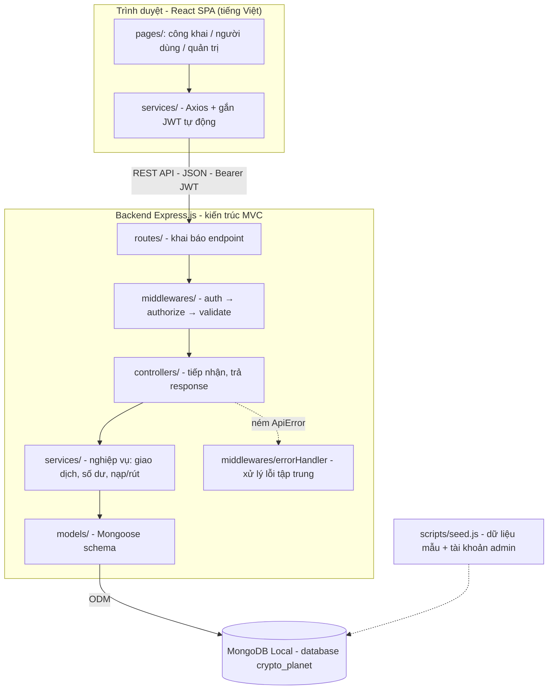
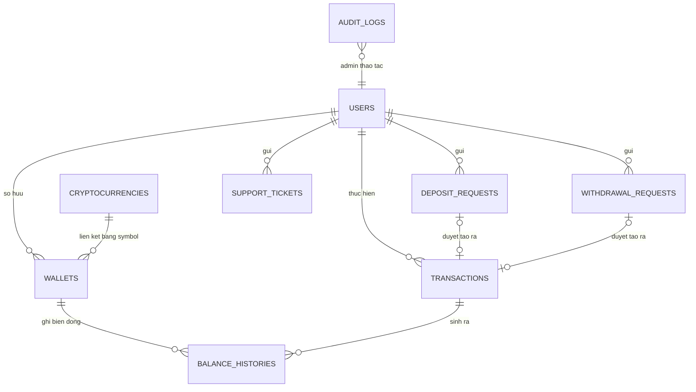
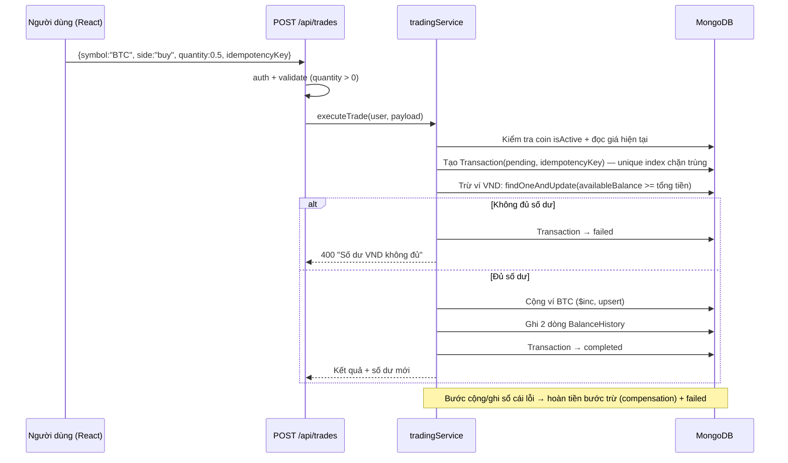

# 🪐 TÀI liệu THIẾT KẾ HỆ THỐNG — CRYPTO PLANET

> Sàn giao dịch tiền điện tử **mô phỏng** phục vụ học tập — MERN Stack, MongoDB Local, giao diện tiếng Việt.
> **Lưu ý quan trọng:** Toàn hệ thống dùng số dư nội bộ mô phỏng, không kết nối blockchain, không tiền thật.
>
> **Trạng thái các quyết định (đã xác nhận với chủ dự án):**
> 1. Phí giao dịch **0.5% ngay từ đầu** (cấu hình qua biến môi trường `TRADE_FEE_PERCENT`).
> 2. Rút tiền **không khóa số dư trước** — kiểm tra đủ tiền tại thời điểm Admin duyệt (update nguyên tử).
> 3. Frontend dùng **Vite**.
> 4. Kiểm thử chính bằng **Postman** (kèm 1 script smoke-test Node đơn giản, không bắt buộc).
> 5. Ghi chú kỹ thuật: dùng `bcryptjs` (thuật toán bcrypt thuần JavaScript) để tránh lỗi biên dịch native trên Windows.

---

## 1. TỔNG QUAN VÀ PHẠM VI DỰ ÁN

### 1.1. Thông tin chung

| Hạng mục | Nội dung |
|---|---|
| Tên dự án | Crypto Planet |
| Mục tiêu | Website mô phỏng sàn giao dịch: theo dõi giá, quản lý tài sản, mua/bán bằng số dư VND nội bộ |
| Đối tượng | Người dùng Việt Nam + Quản trị viên; giao diện 100% tiếng Việt |
| Frontend | React.js + React Router + CSS, tạo project bằng Vite |
| Backend | Node.js + Express.js theo mô hình MVC |
| Database | MongoDB Local (`mongodb://127.0.0.1:27017/crypto_planet`) + Mongoose |
| Kiểm thử API | Postman (bộ sưu tập kèm theo trong `docs/postman/`) |

### 1.2. Các quyết định thiết kế chính (và lý do)

| # | Quyết định | Lý do (chọn phương án đơn giản nhất vẫn đủ yêu cầu) |
|---|---|---|
| 1 | Backend **monolithic MVC** (`routes → middlewares → controllers → services → models`) | Đúng yêu cầu, dễ học, dễ debug, không microservices |
| 2 | **VND cũng là một "tài sản"** trong ví: ví có `currencySymbol = 'VND'` | Chỉ có **một code path duy nhất** cho mọi số dư; nạp/rút chỉ tác động ví VND |
| 3 | **Chỉ lệnh thị trường** (mua/bán tức thời) ở bản gốc; **không cần collection Orders** | Giao dịch khớp ngay theo giá hệ thống → bản ghi `Transaction` là đủ; lệnh giới hạn là tính năng mở rộng |
| 4 | **Không có collection "cặp giao dịch"** — mọi crypto đang hoạt động đều giao dịch với VND | Giảm 1 collection + 1 luồng quản lý mà vẫn đáp ứng yêu cầu |
| 5 | Giá lưu trong MongoDB (seed ban đầu + Admin cập nhật), **không gọi API giá ngoài** | Đủ dùng, không phụ thuộc internet; API ngoài là mở rộng |
| 6 | Bảo đảm số dư bằng **update có điều kiện `findOneAndUpdate` + `$gte`** kèm cơ chế hoàn tác (compensation), **không bắt buộc MongoDB transactions** | Multi-document transactions yêu cầu replica set — rào cản không cần thiết cho MongoDB Local standalone |
| 7 | **Chống giao dịch trùng lặp** bằng `idempotencyKey` do client tạo + unique index | Gửi lại cùng request → trả về kết quả gốc, không trừ tiền lần 2 |
| 8 | **Sổ cái nhất quán:** mọi biến động số dư đều tạo 1 bản ghi `Transaction` + ≥1 bản ghi `BalanceHistory` | Một quy tắc duy nhất, dễ đối soát, dễ kiểm thử |
| 9 | **Phí giao dịch 0.5%** (biến môi trường `TRADE_FEE_PERCENT`) | Đã xác nhận: bật ngay từ đầu; thống kê phí hoạt động ngay |
| 10 | **Rút tiền:** trừ số dư **tại thời điểm Admin duyệt** (kiểm tra đủ tiền bằng update nguyên tử). Không khóa tiền trước | Tránh semantics phức tạp của `lockedBalance` trong sổ cái. Nếu không đủ tiền lúc duyệt → API trả 400, Admin từ chối thủ công, số dư không sai lệch |
| 11 | **Số liệu tài chính:** tiền VND lưu **số nguyên** (đồng); số lượng crypto làm tròn **8 chữ số thập phân** bằng hàm dùng chung | Tránh lỗi số thực phổ biến (0.1 + 0.2) mà không cần khái niệm "satoshi" |
| 12 | JWT lưu `localStorage` + header `Authorization: Bearer`; đăng xuất = xóa token phía client | Đơn giản, phổ biến trong MERN tutorials. httpOnly cookie là nâng cao (ngoài phạm vi) |
| 13 | Enum lưu **giá trị tiếng Anh** (VD: `completed`), hiển thị **tiếng Việt** qua bảng nhãn | Dữ liệu ổn định, dễ code, UI tiếng Việt tự nhiên |
| 14 | `symbol` của tiền điện tử **không cho sửa** sau khi tạo | Wallets/Transactions tham chiếu bằng symbol dạng chuỗi — đổi symbol sẽ làm gãy dữ liệu |

### 1.3. Phạm vi

- **Trong phạm vi:** tài khoản, thị trường, ví, giao dịch lệnh thị trường, nạp/rút mô phỏng có phê duyệt, hỗ trợ, thông báo, FAQ, quản trị, thống kê, phí giao dịch 0.5%.
- **Ngoài phạm vi:** tiền thật, blockchain thực, cổng thanh toán, KYC/AML, 2FA, sổ lệnh đầy đủ, margin/phái sinh, WebSocket realtime (dùng polling), deploy production, refresh token, biểu đồ giá & lệnh giới hạn (G3 — mở rộng sau).

---

## 2. CHỨC NĂNG THEO TỪNG VAI TRÒ

Phân loại: **BB** = Bắt buộc, **TC** = Tùy chọn, **NPA** = Ngoài phạm vi.

### 2.1. Khách truy cập (Guest)

| Chức năng | Chi tiết | Phân loại |
|---|---|---|
| Trang chủ | Giới thiệu Crypto Planet, bảng giá nổi bật | BB |
| Xem thị trường | Danh sách tiền điện tử, giá VND, % biến động, tìm kiếm, sắp xếp | BB |
| Chi tiết tài sản | Giá hiện tại, biến động, mô tả | BB |
| Đăng ký / Đăng nhập | Trang + biểu mẫu, lỗi bằng tiếng Việt | BB |

Guest **không** được: giao dịch, xem ví, nạp/rút, gửi hỗ trợ, vào trang quản trị (backend chặn bằng middleware).

### 2.2. Người dùng (User)

| Nhóm | Chức năng | Phân loại |
|---|---|---|
| **Tài khoản** | Đăng ký, đăng nhập, đăng xuất; xem/sửa thông tin cá nhân; xem trạng thái tài khoản; đổi mật khẩu | BB |
| **Thị trường** | Danh sách, giá, biến động, tìm kiếm/lọc | BB |
| **Tài sản** | Số dư từng loại tiền, tổng giá trị quy đổi VND, lịch sử biến động số dư, lịch sử nạp/rút | BB |
| **Giao dịch** | Chọn tài sản, nhập số lượng, xem giá trị dự kiến (kèm phí 0.5%), xác nhận, xem kết quả, lịch sử có phân trang + bộ lọc, trạng thái giao dịch | BB |
| | Hủy lệnh đang chờ | TC (chỉ có ý nghĩa khi có lệnh giới hạn) |
| **Nạp/Rút** | Tạo yêu cầu nạp/rút VND mô phỏng, theo dõi trạng thái (Chờ duyệt/Đã duyệt/Bị từ chối) | BB |
| | Hủy yêu cầu rút đang chờ duyệt | TC |
| **Hỗ trợ** | Xem FAQ, gửi yêu cầu hỗ trợ, theo dõi trạng thái | BB |
| **Thông báo** | Xem thông báo hệ thống | BB |

### 2.3. Quản trị viên (Admin)

| Nhóm | Chức năng | Phân loại |
|---|---|---|
| **Người dùng** | Danh sách, tìm kiếm; xem chi tiết + lịch sử giao dịch từng user; khóa/mở khóa | BB |
| **Tiền điện tử** | Thêm, sửa (tên/giá/biến động/mô tả), ẩn hoặc ngừng hỗ trợ (`isActive`) | BB |
| **Giao dịch** | Xem toàn bộ, lọc theo user/loại/tài sản/trạng thái; theo dõi giao dịch thất bại | BB |
| **Số dư** | Xem số dư user; điều chỉnh số dư (bắt buộc có **lý do**), tự động ghi nhật ký kiểm toán | BB |
| **Nạp/Rút** | Xem, phê duyệt, từ chối kèm ghi chú | BB |
| **Nội dung** | Đăng/thêm/sửa thông báo; quản lý FAQ; phản hồi ticket | BB |
| **Thống kê** | Tổng user, tổng giao dịch, khối lượng, thành công/thất bại, khối lượng từng tiền, doanh thu phí 0.5% | BB |
| **Nhật ký** | Xem nhật ký thao tác quản trị (audit log) — API có sẵn; trang UI là mở rộng | TC |

### 2.4. Ngoài phạm vi

Giao dịch tiền thật, ví blockchain, cổng thanh toán, sổ lệnh public, margin, 2FA, KYC/AML, refresh token, WebSocket, deploy production.

---

## 3. KIẾN TRÚC HỆ THỐNG



**Luồng xử lý request chuẩn:**
1. React gửi request qua Axios kèm `Authorization: Bearer <token>`.
2. `routes/` định tuyến → middleware `auth` (giải mã JWT → `req.user`) → `authorize` (role/status) → `validate` (express-validator).
3. `controllers/` tiếp nhận, gọi `services/`.
4. `services/` chứa toàn bộ logic nghiệp vụ: kiểm tra số dư, **tính giá phía backend**, update nguyên tử, ghi sổ cái.
5. Lỗi nghiệp vụ ném `ApiError` → `errorHandler` tập trung → response JSON thống nhất tiếng Việt.

Tách `controllers/` và `services/` để logic số dư (`walletService`) được dùng chung cho giao dịch, nạp/rút, điều chỉnh admin — **một nơi duy nhất bảo đảm không số dư âm và ghi sổ cái**.

---

## 4. CẤU TRÚC THƯ MỤC

### 4.1. Backend

```
backend/
├── src/
│   ├── config/db.js               # kết nối mongoose
│   ├── models/                    # User, Cryptocurrency, Wallet, Transaction,
│   │                              # BalanceHistory, DepositRequest, WithdrawalRequest,
│   │                              # SupportTicket, Notification, Faq, AuditLog
│   ├── middlewares/               # auth, authorize, validate, notFound, errorHandler
│   ├── controllers/               # + admin/ (7 controller quản trị)
│   ├── services/                  # auth, market, wallet, trading, cash, support, stat, audit
│   ├── routes/                    # index + 8 file theo nhóm API
│   ├── utils/                     # ApiError, asyncHandler, round, pagination, string, constants
│   ├── app.js / server.js
├── scripts/seed.js                # admin + 10 coin mẫu + user demo + FAQ + thông báo
├── scripts/smokeTest.js           # kiểm thử nhanh toàn luồng bằng Node fetch (tùy chọn)
├── .env / .env.example
└── package.json
```

### 4.2. Frontend (Vite)

```
frontend/
├── src/
│   ├── pages/
│   │   ├── public/   # Home, Market, CryptoDetail, Login, Register
│   │   ├── user/     # Trade, Wallet, Transactions, CashRequests, Profile, Support, Notifications
│   │   └── admin/    # Dashboard, Users, UserDetail, Cryptos, Transactions, Cash, Tickets, Content
│   ├── components/common/         # Spinner, EmptyState, ErrorAlert, StatusBadge,
│   │                              # Pagination, ConfirmModal, Toast
│   ├── layouts/                   # PublicLayout, UserLayout, AdminLayout
│   ├── services/                   # api.js (axios) + 8 module API theo nhóm
│   ├── context/AuthContext.jsx    # {user, loading, login, setSession, logout}
│   ├── hooks/useApi.js             # tải dữ liệu + loading/error/reload
│   ├── router/                     # AppRoutes, RequireAuth (user/admin)
│   └── utils/format.js             # formatVND, formatDate, bảng nhãn tiếng Việt
└── package.json
```

### 4.3. Trang & route

| Đường dẫn | Trang | Quyền |
|---|---|---|
| `/`, `/market`, `/market/:symbol`, `/login`, `/register` | Công khai | Guest+ |
| `/trade/:symbol?`, `/wallet`, `/transactions`, `/cash`, `/profile`, `/support`, `/notifications` | Người dùng | User |
| `/admin`, `/admin/users`, `/admin/users/:id`, `/admin/cryptos`, `/admin/transactions`, `/admin/cash`, `/admin/tickets`, `/admin/content` | Quản trị | Admin |

Frontend guard chỉ để trải nghiệm UI; quyền thật sự kiểm tra ở backend.

---

## 5. THIẾT KẾ CƠ SỞ DỮ LIỆU MONGODB

### 5.1. Quan hệ



- ObjectId `ref` cho quan hệ chính; `WALLETS.currencySymbol` tham chiếu `CRYPTOCURRENCIES.symbol` bằng **chuỗi** (ví `VND` không cần bản ghi crypto).
- 1 giao dịch (mua/bán) sinh 2 dòng sổ cái (trừ VND + cộng coin).

### 5.2. Các collection chính

**users** — `name` (2–50), `email` (unique, lowercase), `password` (hash bcryptjs, `select:false`), `role` enum `['user','admin']`, `status` enum `['active','locked']`, timestamps.

**cryptocurrencies** — `name`, `symbol` (unique, uppercase, **immutable**), `currentPriceVND` (số nguyên, ≥1), `changePercent`, `isActive`, `description` (tùy chọn), timestamps.

**wallets** — `userId`, `currencySymbol` ('VND' hoặc mã coin), `availableBalance` (default 0, ≥0), timestamps. **Unique index `{userId, currencySymbol}`**.

**transactions** — `userId`, `type` enum `['trade','deposit','withdrawal','adjustment']`, `side` enum `['buy','sell']` (chỉ trade), `currencySymbol`, `quantity` (>0), `price` (giá tại thời điểm thực hiện), `totalValueVND`, `feeVND` (default 0), `status` enum `['pending','completed','failed','cancelled']`, `idempotencyKey` (unique sparse theo user), `referenceId`, `note`, timestamps. Index: `{userId, idempotencyKey}` unique sparse, `{userId, createdAt}`, `{status}`, `{type}`, `{currencySymbol}`.

**balance_histories** — `userId`, `walletId`, `transactionId` (bắt buộc), `changeAmount` (±), `balanceBefore`, `balanceAfter`, `reason`, `createdAt`. Index: `{userId, createdAt}`, `{walletId, createdAt}`, `{transactionId}`.

**deposit_requests** — `userId`, `amountVND` (nguyên > 0, ≥ min), `status` enum `['pending','approved','rejected']`, `adminNote`, `processedBy`, `processedAt`, timestamps.

**withdrawal_requests** — như deposit + `status` enum `['pending','approved','rejected','cancelled']` (cancelled = user hủy khi đang chờ).

**support_tickets** — `userId`, `subject` (5–100), `message` (10–2000), `status` enum `['open','answered','closed']`, `adminResponse`, `respondedBy/respondedAt`.

**notifications** — `title`, `content`, `type` enum `['announcement','system','maintenance']`, `isPublished`, `createdBy`, timestamps.

**faqs** — `question`, `answer`, `order`, `isActive`.

**audit_logs** — `actorId`, `action` (VD: `lock_user`, `adjust_balance`, `approve_deposit`…), `targetType`, `targetId`, `reason` (bắt buộc với adjust_balance), `details`, `createdAt`.

### 5.3. Bảo đảm số dư không âm, không cập nhật sai

**Nguyên tắc vàng — kiểm tra + cập nhật trong MỘT thao tác nguyên tử:**

```text
wallet = Wallet.findOneAndUpdate(
  { userId, currencySymbol: 'VND', availableBalance: { $gte: totalDebit } },
  { $inc: { availableBalance: -totalDebit } },
  { new: true }
)
if (!wallet) → 400 "Số dư VND không đủ"
```

- Hai request đồng thời không thể cùng pass điều kiện `$gte` (request sau thấy số dư đã giảm).
- Cộng tiền: `$inc` + `upsert: true` (tự tạo ví).
- Không bao giờ tính số dư mới bằng JS rồi `save()` (lỗi race phổ biến nhất).

### 5.4. Chống giao dịch trùng (idempotency)

1. Frontend tạo `idempotencyKey = crypto.randomUUID()` mỗi lần bấm xác nhận.
2. Backend chèn `Transaction(pending)` với unique index `{userId, idempotencyKey}`:
   - Key mới → thực hiện giao dịch.
   - Key trùng + cùng payload → trả về kết quả gốc (200), không thực hiện lại.
   - Key trùng + khác payload → 409.
3. Chèn Transaction trước khi trừ tiền chính là "nhận quyền" thực hiện — request song song thua cuộc dừng ở lỗi duplicate.

### 5.5. Khi nào cần MongoDB transactions?

Multi-document transactions cần replica set → bản gốc **không dùng**, thay bằng update nguyên tử (5.3) + **compensation**: nếu trừ VND xong nhưng cộng coin lỗi → hoàn lại đúng số tiền (kèm dòng sổ cái "Hoàn tiền giao dịch lỗi"), đánh dấu Transaction `failed`. Nâng cấp: single-node replica set + `session.withTransaction()` (G3).

### 5.6. Quy ước số liệu

- VND: **số nguyên đồng** (`Math.round`).
- Số lượng crypto: làm tròn **8 chữ số thập phân** (`roundQuantity`).

---

## 6. RESTful API

Quy ước: prefix `/api`; `[C]` công khai, `[U]` cần đăng nhập, `[A]` chỉ admin.
Thành công `{ success: true, data }` — Lỗi `{ success: false, message (tiếng Việt), code }`.
Phân trang: `?page=&limit=` → `data = { items, page, limit, total, totalPages }`.
Status: 200/201, 400 dữ liệu sai, 401 chưa đăng nhập, 403 sai quyền/tài khoản bị khóa, 404 không tồn tại, 409 trùng, 500 hệ thống.

### 6.1. Authentication
| Method | URL | Quyền | Mục đích |
|---|---|---|---|
| POST | `/api/auth/register` | [C] | Đăng ký `{name, email, password}` → `{token, user}` |
| POST | `/api/auth/login` | [C] | Đăng nhập → `{token, user}` |
| GET | `/api/auth/me` | [U] | Thông tin tài khoản hiện tại |
| PUT | `/api/auth/me` | [U] | Cập nhật tên hiển thị |
| PUT | `/api/auth/change-password` | [U] | Đổi mật khẩu `{currentPassword, newPassword}` |
| POST | `/api/auth/logout` | [U] | MVP: client xóa token |

### 6.2. Market
| Method | URL | Quyền | Mục đích |
|---|---|---|---|
| GET | `/api/market/cryptocurrencies` | [C] | Danh sách + tìm kiếm `?q=&sort=&order=` + phân trang (kèm `feePercent`) |
| GET | `/api/market/cryptocurrencies/:symbol` | [C] | Chi tiết tài sản |

### 6.3. Wallet
| Method | URL | Quyền | Mục đích |
|---|---|---|---|
| GET | `/api/wallets` | [U] | Số dư từng ví + `totalValueVND` |
| GET | `/api/wallets/histories` | [U] | Lịch sử biến động số dư `?currencySymbol=&page=` |

### 6.4. Trading
| Method | URL | Quyền | Mục đích |
|---|---|---|---|
| POST | `/api/trades` | [U] | Mua/bán `{symbol, side, quantity, idempotencyKey}` — giá do backend tự lấy |
| GET | `/api/trades` | [U] | Lịch sử giao dịch `?symbol=&side=&status=&from=&to=&page=` |
| GET | `/api/trades/:id` | [U] | Chi tiết giao dịch (chỉ chủ sở hữu) |

### 6.5. Deposit & Withdrawal
| Method | URL | Quyền | Mục đích |
|---|---|---|---|
| POST/GET | `/api/deposits` | [U] | Tạo / danh sách yêu cầu nạp `{amountVND}` |
| POST/GET | `/api/withdrawals` | [U] | Tạo / danh sách yêu cầu rút |
| POST | `/api/withdrawals/:id/cancel` | [U] | Hủy yêu cầu rút đang chờ |

### 6.6. Support, FAQ, Notifications
| Method | URL | Quyền | Mục đích |
|---|---|---|---|
| POST/GET | `/api/support/tickets` | [U] | Gửi / danh sách ticket của tôi |
| GET | `/api/support/tickets/:id` | [U] | Chi tiết ticket (chủ sở hữu) |
| GET | `/api/faqs` | [C] | FAQ đang hiển thị |
| GET | `/api/notifications` | [U] | Thông báo đã đăng |

### 6.7. Admin (tất cả qua `auth` + `authorize('admin')`)
| Method | URL | Mục đích |
|---|---|---|
| GET | `/api/admin/stats` | Thống kê tổng quan (user, gd, khối lượng, phí, chờ duyệt…) |
| GET | `/api/admin/users` | Danh sách `?q=&status=&page=` |
| GET | `/api/admin/users/:id` | Chi tiết + ví + tổng hợp |
| PATCH | `/api/admin/users/:id/status` | Khóa/mở `{status, reason}` (lý do bắt buộc, ghi audit) |
| GET | `/api/admin/users/:id/transactions` | Giao dịch của user |
| GET | `/api/admin/users/:id/balance-histories` | Sổ cái của user |
| POST | `/api/admin/users/:id/balances` | Điều chỉnh số dư `{currencySymbol, changeAmount, reason}` (lý do bắt buộc) |
| GET/POST | `/api/admin/cryptocurrencies` | Danh sách đầy đủ / thêm coin |
| PUT | `/api/admin/cryptocurrencies/:symbol` | Sửa/ẩn/kích hoạt (không cho sửa symbol) |
| GET | `/api/admin/transactions` | Toàn bộ giao dịch `?email=&type=&status=&symbol=&page=` |
| GET | `/api/admin/deposits` + `POST .../:id/approve` + `POST .../:id/reject` | Duyệt/từ chối nạp |
| GET | `/api/admin/withdrawals` + approve/reject | Duyệt/từ chối rút |
| GET/PUT | `/api/admin/tickets` + `/:id` | Phản hồi/đóng ticket |
| CRUD | `/api/admin/notifications`, `/api/admin/faqs` | Quản lý nội dung |
| GET | `/api/admin/audit-logs` | Nhật ký thao tác quản trị |

---

## 7. LUỒNG XỬ LÝ CHÍNH

### 7.1. Đăng nhập
Submit → tìm user kèm password → `bcrypt.compare` (sai → 401 "Email hoặc mật khẩu không đúng") → `status === 'locked'` → 403 → ký JWT `{userId, role}` → frontend lưu localStorage + AuthContext → mọi request gắn Bearer → 401 interceptor tự logout.

### 7.2. Mua/bán (luồng quan trọng nhất)



Tính toán (backend tự tính): `totalValue = round(qty × price)`; `fee = round(totalValue × 0.5%)`;
Mua: `trừ VND (totalValue + fee)`, `cộng coin qty`. Bán: `trừ coin qty`, `cộng VND (totalValue − fee)`.

### 7.3. Nạp tiền (mô phỏng)
1. User tạo yêu cầu → `DepositRequest(pending)`, **chưa** đổi số dư.
2. Admin duyệt → atomic `pending → approved` (chặn duyệt 2 lần) → tạo Transaction → **cộng ví VND** qua walletService → sổ cái + AuditLog.
3. Từ chối → chỉ đổi status + ghi chú, số dư **không** đổi.

### 7.4. Rút tiền (mô phỏng)
1. User tạo yêu cầu → `WithdrawalRequest(pending)`, chưa đổi số dư.
2. Admin duyệt → atomic pending → approved → **trừ ví VND có điều kiện $gte**. Nếu user đã hết tiền → API 400 "Số dư hiện tại không đủ", Admin từ chối thủ công — không có gì sai lệch.
3. Từ chối / user hủy khi pending → chỉ đổi status.

### 7.5. Điều chỉnh số dư bởi Admin
`reason` bắt buộc (≥5 ký tự) → Transaction(adjustment) + ví cập nhật nguyên tử (không cho âm) + BalanceHistory + AuditLog. Lịch sử của user hiển thị công khai dòng điều chỉnh này.

---

## 8. BẢO MẬT VÀ XỬ LÝ LỖI

| Lĩnh vực | Cách làm | Lỗi phổ biến cần tránh |
|---|---|---|
| Mật khẩu | bcryptjs (salt ≥ 10), `select: false`, không trả trong response | Lưu plain; trả user đầy đủ sau đăng nhập |
| JWT | Secret ≥ 32 ký tự trong `.env`; payload `{userId, role}`; hết hạn 7 ngày | Hardcode secret; commit `.env` |
| Xác thực | Middleware auth cho mọi route riêng tư; kiểm tra user tồn tại + `status` mỗi request | Chỉ verify token, không kiểm tra tài khoản bị khóa |
| Phân quyền | `authorize('admin')` từ DB; 403 khi không đủ quyền | Chỉ ẩn UI mà backend không chặn |
| Đầu vào | express-validator mọi endpoint; quantity > 0, `isFinite`, amount nguyên | Tin `req.body` nguyên vẹn |
| Giá giao dịch | Backend đọc giá từ DB, request không có trường giá | Nhận giá từ frontend |
| Số dư | Update nguyên tử `$gte` + idempotency | Check-then-update tách 2 bước; `$inc` không điều kiện |
| Truy cập | Mọi query theo `req.user`; truy cập dữ liệu người khác → 404 (IDOR) | Lấy userId từ body/params |
| Lỗi | `errorHandler` tập trung, message tiếng Việt; production giấu stack | Trả `err.stack` / raw Mongo error |
| CORS | `origin: CLIENT_URL` | Mở `*` tùy tiện |

Xử lý lỗi tập trung: `ApiError(statusCode, code, message)` + `asyncHandler`; ValidationError → 400; duplicate key → 409; CastError → 404; JsonWebTokenError → 401; còn lại → 500 + log server.

Frontend: interceptor Axios hiện Toast tiếng Việt; 401 → logout + chuyển `/login`; trang có 3 trạng thái: đang tải / danh sách trống / lỗi API + "Thử lại".

Ngoài phạm vi: 2FA, httpOnly cookie, refresh token, KYC/AML, WebSocket.

---

## 9. TRƯỜNG HỢP KIỂM THỨNG

Bộ đầy đủ nằm trong `docs/postman/` (Postman) và `backend/scripts/smokeTest.js` (chạy tự động). Tóm tắt các nhóm chính:

| Nhóm | Các trường hợp |
|---|---|
| Xác thực | Đăng ký hợp lệ/trùng email; mật khẩu yếu; đăng nhập sai; tài khoản bị khóa (403); API riêng tư không token (401); user gọi API admin (403); user A xem giao dịch user B (404) |
| Giao dịch | Mua đủ/thiếu VND; bán đủ/thiếu coin; quantity 0/âm/NaN; symbol không tồn tại (404); coin bị ẩn (400); **trùng idempotencyKey → trả kết quả gốc, chỉ trừ 1 lần**; 2 request đồng thời khi đủ 1; lỗi giữa chừng → hoàn tiền, số dư nguyên vẹn; tài khoản bị khóa (403) |
| Nạp/rút | Tạo yêu cầu chưa đổi số dư; duyệt nạp cộng đúng tiền + audit; từ chối không đổi số dư; duyệt 2 lần (409); duyệt rút khi hết tiền (400); số tiền âm/0/dưới min (400) |
| Quản trị | Khóa user → mọi API 403; điều chỉnh thiếu lý do (400); điều chỉnh gây âm (400); sửa symbol (400); ẩn coin → biến mất khỏi thị trường; đối soát sổ cái `before + change = after`; thống kê khớp |

---

## 10. KẾ HOẠCH TRIỂN KHAI

| Giai đoạn | Nội dung | Trạng thái |
|---|---|---|
| **G0 — Nền móng** | Cấu trúc repo, `.env`, kết nối DB, error handling, seed | ✅ Triển khai trong bản này |
| **G1 — MVP lõi** | Auth, Market, Ví + Giao dịch lệnh thị trường + idempotency + sổ cái, Admin (user, coin, điều chỉnh số dư, thống kê) | ✅ Triển khai trong bản này |
| **G2 — Hoàn thiện** | Nạp/rút + phê duyệt, Hỗ trợ + FAQ, Thông báo, hồ sơ, phân trang/bộ lọc, UI hoàn chỉnh | ✅ Triển khai trong bản này |
| **G3 — Mở rộng** | Biểu đồ giá (Recharts + PriceHistory + mô phỏng giá), lệnh giới hạn, khóa tiền khi rút, replica set + transactions, Jest/Supertest | ⏳ Tùy chọn, làm sau nếu còn thời gian |

Thứ tự thực hiện G1: seed → auth middleware → auth API → market → walletService → tradingService → UI giao dịch → authorize admin → admin API/UI. **Luôn làm service + test Postman trước khi làm UI.**
